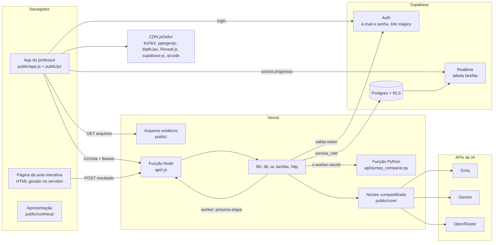
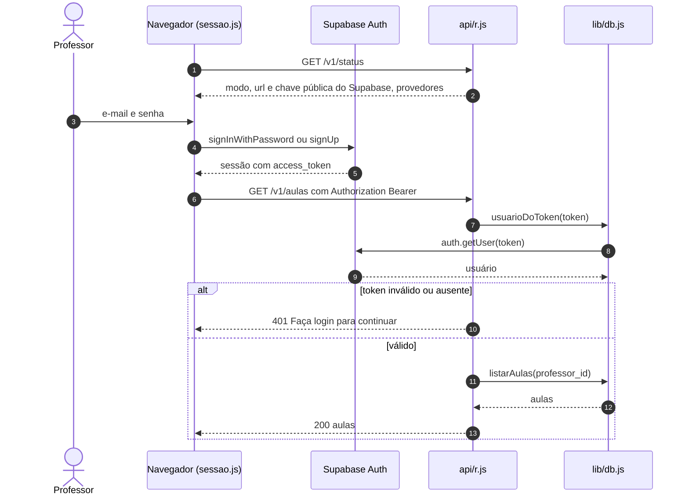
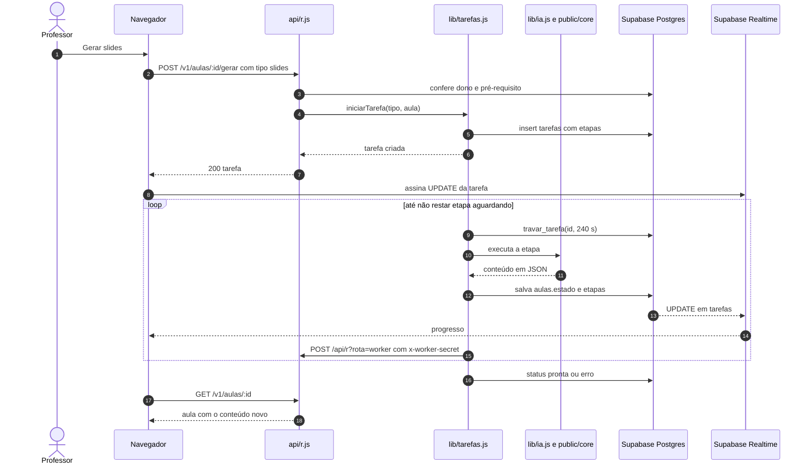
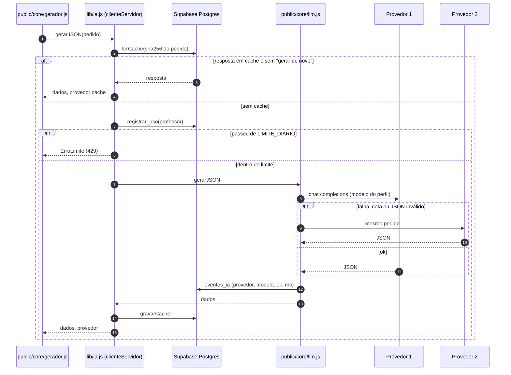
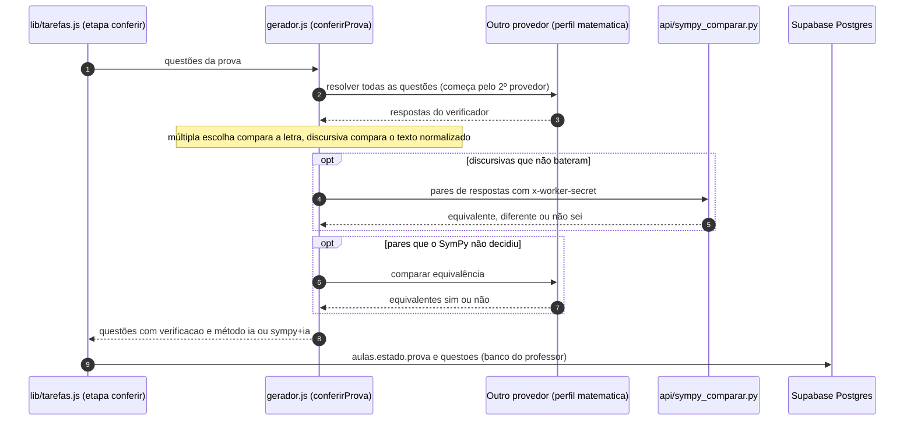
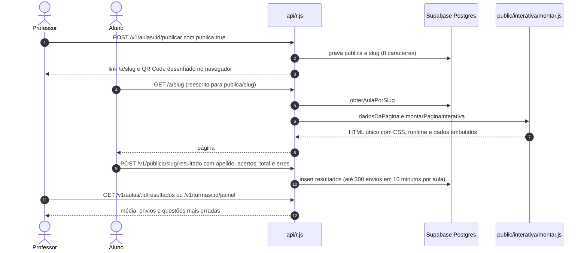

# Arquitetura e fluxos do sistema

[← README](../README.md) · [Fluxo de dados](FLUXO_DADOS.md) · [Casos de uso](CASOS_DE_USO.md) · [Operação e deploy](OPERACAO_E_DEPLOY.md)

## 1. Visão macro

O Proff é um site estático com uma API serverless. Não há framework nem bundler: o navegador carrega módulos ES direto de `public/`, e o servidor é **uma única função Node na Vercel** (`api/r.js`) mais uma função Python (`api/sympy_comparar.py`). Os dados e o login ficam no Supabase, e o conteúdo é gerado por APIs gratuitas de IA chamadas só pelo servidor.

### Camadas e módulos

| Camada | Caminho | Papel |
|---|---|---|
| Telas do professor | `public/app.js`, `public/js/views/aula.js`, `public/js/views/listas.js` | Roteamento por hash (`#/aulas`, `#/aula/<id>`, `#/turmas`, `#/bimestre`, `#/banco`, `#/comunidade`, `#/nova`) |
| Sessão e fila no cliente | `public/js/sessao.js` | Login Supabase, token, acompanhamento de tarefas (realtime + consulta a cada 3 s) |
| Cliente HTTP | `public/js/api.js` | `get`/`post`/`patch`/`del` em `/v1/...` com `Authorization: Bearer` |
| Componentes de DOM | `public/js/ui.js` | `el()`, janelas, avisos (`textContent`, nunca `innerHTML`) |
| Slides | `public/slides-render.js`, `public/slides.html`, `public/pptx.js`, `public/pptx-matematica.js` | Pré-visualização, apresentação em tela cheia e exportação `.pptx` no navegador |
| Núcleo compartilhado | `public/core/` | Prompts, cliente de IA com troca de provedor, validação, montagem de prova/slides, LaTeX; roda no navegador **e** no Node |
| API | `api/r.js` | Roteador próprio (`rota(MÉTODO, 'padrão', fn)`), autenticação, posse dos dados, conversão de erros |
| Serviços do servidor | `lib/db.js`, `lib/ia.js`, `lib/tarefas.js`, `lib/http.js`, `lib/resultados.js`, `lib/bncc.js` | Dados, IA com cache/limite, fila de geração, utilitários |
| Conferência simbólica | `api/sympy_comparar.py` | Compara respostas discursivas com SymPy |
| Banco | `supabase/migrations/20261124000000_proff.sql` | Tabelas, RLS, funções RPC, gatilhos, realtime, BNCC |
| Servidor local | `server.js` | Serve `public/`, imita as reescritas da Vercel e chama `api/r.js` |

### Integrações externas

| Serviço | Uso | Onde |
|---|---|---|
| Supabase Auth | Cadastro, login por senha ou link, recuperação de senha; validação do token no servidor | `public/js/sessao.js`, `lib/db.js` (`usuarioDoToken`) |
| Supabase Postgres | Todos os dados (via `service_role` no servidor) | `lib/db.js` |
| Supabase Realtime | Progresso das tarefas em tempo real (`postgres_changes` em `tarefas`) | `public/js/sessao.js` |
| Groq, Gemini, OpenRouter | Geração de conteúdo e conferência de gabarito | `public/core/llm.js`, `lib/ia.js` |
| jsDelivr | KaTeX, pptxgenjs, MathJax (fórmulas em imagem no .pptx), Reveal.js (apresentação), docx 9.8.1 (planejamento em Word), supabase-js, qrcode-generator | `public/index.html`, `public/slides.html`, `public/pptx-matematica.js`, `public/js/sessao.js`, `public/js/views/aula.js` |
| Google Classroom e WhatsApp | Só links de compartilhamento (`classroom.google.com/share?url=…`, `wa.me/?text=…`); sem API | `public/js/views/aula.js` |

## 2. Fluxos principais

### 2.1 Login e chamada autenticada

O navegador faz login direto no Supabase. Cada chamada à API leva o `access_token`, e o servidor confirma o usuário com `auth.getUser(token)`. No modo de demonstração (`DB_MEMORIA=1`), o login é só um e-mail (`POST /v1/login-demo`) e o token fica em memória.

Outros caminhos de login no cliente (`public/js/sessao.js`): link por e-mail (`signInWithOtp`), "Esqueci / criar senha" (`resetPasswordForEmail` e evento `PASSWORD_RECOVERY`, que abre a janela de nova senha) e o botão **Senha** para quem já está logado (`updateUser`).

### 2.2 Geração em segundo plano (fila de tarefas)

Cada parte da aula (plano, slides, prova, interativa) e o planejamento do bimestre viram uma **tarefa** com uma lista de `etapas`. Cada execução da função faz **uma etapa** e chama a próxima por HTTP, para que nenhuma execução passe do tempo limite da Vercel. A trava (`travar_tarefa`) impede dois workers na mesma etapa.

Detalhes do encadeamento (`lib/tarefas.js`):

- `iniciarTarefa` cria a linha e já roda a 1ª etapa na mesma execução (`processar`).
- `agendar` chama o worker em `APP_URL` ou `VERCEL_URL`. Sem endereço, ou no modo memória, roda as etapas em sequência no mesmo processo (`FILA_HTTP=1` força o HTTP em teste).
- `emSegundoPlano` usa `waitUntil` de `@vercel/functions` para manter a execução viva depois da resposta.
- `retomarSeParada` é chamada por `GET /v1/aulas/:id`, `GET /v1/tarefas/:id` e `GET /v1/sequencias/:id`: se a tarefa está pendente ou rodando, sem trava e parada há mais de 20 s, a etapa roda de novo ali mesmo.
- Etapas presas em `gerando` (worker caiu) voltam para `aguardando`. `dependeDeFalha` marca como erro as etapas que dependem de uma que falhou, e a etapa `visualizacoes` é opcional.

Etapas por tipo (`etapasDaTarefa`):

| Tipo | Etapas |
|---|---|
| `plano` | `visao` → `plano` |
| `slides` | `material:<seção>` e `formatar:<seção>` para cada seção de `public/core/estrutura.js` → `montar-slides` |
| `prova` | `questoes:multipla` → `questoes:discursiva` → `conferir` |
| `interativa` | `artigo:<seção>` para cada seção → `visualizacoes` (opcional) → `jogos` |
| `sequencia` | `sequencia` (lista de aulas, pulada se já existe) → `planejamento` (opcional: ementa, BNCC, objetivos, conteúdos, competências, avaliação) |

### 2.3 Chamada à IA (cache, limite, troca de provedor)

- Ordem padrão: `groq` → `gemini` → `openrouter` (`ORDEM_DE_USO`). `lib/ia.js` manda para o fim um provedor com 3 ou mais chamadas e taxa de erro acima de 50% nos últimos 30 minutos (`saude_provedores`), consultado no máximo uma vez por minuto.
- Cada provedor tem uma **lista de modelos** por perfil (`texto` ou `matematica`). Se um modelo some ou fica sem cota, tenta o próximo e lembra qual funcionou (`MODELO_QUE_FUNCIONOU`).
- Se todos falharem com erro passageiro (503, 502, 500, 429, tempo esgotado, rede), espera `IA_ESPERA_MS` (4 s) e tenta mais uma vez.
- `corrigirChaves` reconhece a chave pelo prefixo e corrige chaves trocadas entre variáveis.

### 2.4 Conferência do gabarito

`api/sympy_comparar.py` só responde com o cabeçalho `x-worker-secret` correto, aceita uma lista branca de funções e compara números com tolerância pelas casas decimais. No `server.js` local ela responde 501, e a conferência fica só com a IA.

### 2.5 Aula interativa pública

## 3. Decisões técnicas

| Decisão | Motivo (no código) |
|---|---|
| Uma função Node para todas as rotas (`api/r.js`) | Limite de funções do plano gratuito da Vercel (comentário no topo do arquivo) |
| Fila com uma etapa por execução | Evitar o tempo limite das funções e mostrar progresso por etapa |
| `public/core/` compartilhado | O mesmo código de prompts e validação roda no navegador e no servidor; o `vercel.json` inclui a pasta na função (`includeFiles`) |
| Chaves de IA só no servidor | `lib/ia.js` lê do ambiente; o navegador nunca recebe as chaves |
| `service_role` no servidor + RLS no banco | O backend confere o dono no código (`aulaDoProfessor`, `turmaDoProfessor`…) e o RLS protege o acesso direto pelo navegador |
| Modo memória (`DB_MEMORIA=1`) e IA simulada (`LLM_MOCK=1`) | Rodar e testar sem Supabase e sem chaves; os testes de integração usam esse modo |
| `__VERSAO__` nos endereços dos arquivos | Evitar cache antigo no navegador; `scripts/build.js` troca pelo commit no deploy |
| PowerPoint e Word gerados no navegador (pptxgenjs, docx) | A IA gera só o conteúdo; o layout é fixo no código (`public/pptx.js`, `public/core/planejamento-docx.js`) |

## 4. Tratamento de erros

- O roteador (`api/r.js`, função `handler`) converte as exceções: `ErroHttp(status)` → status informado; `ErroEntrada` (de `gerador.js`) → 400; `ErroLimite` → 429; `ErroLLM` → 503; qualquer outra → 500 com mensagem genérica (o detalhe vai para `console.error`). Rota inexistente → 404.
- Validação de entrada no próprio roteador: `id()` (UUID), `inteiro(v, min, max)`, `texto(v, max)` e limite de 400 KB para conteúdo editado; corpo da requisição limitado a 800 KB (`lib/http.js`).
- Na fila, o erro de uma etapa fica na própria etapa (`situacao: 'erro'`, `detalhe`) e a tarefa termina com `status: 'erro'` e a lista do que falhou, sem derrubar as outras etapas.
- No cliente, `traduzirErro` (`public/js/sessao.js`) traduz as mensagens do Supabase Auth, e `mostrarErro`/`aviso` (`public/js/ui.js`) exibem as da API.

## 5. Segurança

- **Autenticação:** todas as rotas exigem token, exceto `status`, `login-demo` (só no modo memória), `bncc`, `publica/:slug`, `publica/:slug/resultado` e `worker`.
- **Autorização:** funções `aulaDoProfessor`, `turmaDoProfessor`, `tarefaDoProfessor` e `sequenciaDoProfessor` respondem 404 quando o item é de outro professor, e as consultas de lista filtram `professor_id` em `lib/db.js`.
- **RLS:** cada tabela só libera ao dono (`auth.uid()`); aulas com `comunidade = true` são legíveis por qualquer professor logado; `bncc` é pública; `cache_ia`, `eventos_ia` e `uso_diario` não têm política, ou seja, ninguém acessa pelo navegador.
- **Chamadas internas:** `worker` e `sympy_comparar` exigem `x-worker-secret` (comparação em tempo constante com `timingSafeEqual`). Em previews protegidos, o cabeçalho `x-vercel-protection-bypass` é enviado quando `VERCEL_AUTOMATION_BYPASS_SECRET` existe.
- **Envio público de resultados:** apelido sem `<` e `>`, até 40 caracteres; acertos não maiores que o total; códigos de erro só no formato `quiz|vf|par|desafio:N`; limite de 300 envios por aula em 10 minutos.
- **XSS:** o DOM é montado com `textContent`; os dados da página interativa entram como JSON escapado (`jsonSeguro` em `public/interativa/montar.js`).
- **Cabeçalhos:** `X-Content-Type-Options: nosniff` e `Referrer-Policy: strict-origin-when-cross-origin` em todas as respostas (`vercel.json`).

## 6. Observabilidade

- Cada chamada de IA vira uma linha em `eventos_ia` (provedor, modelo, tarefa, ok, tempo em ms, erro). A mesma tabela alimenta a ordem dos provedores (`saude_provedores`).
- O uso diário por professor fica em `uso_diario` (`registrar_uso`).
- O progresso de cada geração fica em `tarefas.etapas`, visível ao professor e consultável no banco.
- Erros do servidor vão para o log da função (`console.warn`/`console.error`), visível em **Vercel → Deployments → Functions/Logs**.
- O app mostra no topo os provedores configurados (`GET /v1/status`).
- Não há ferramenta de métricas, alertas ou rastreamento externa configurada no repositório.
