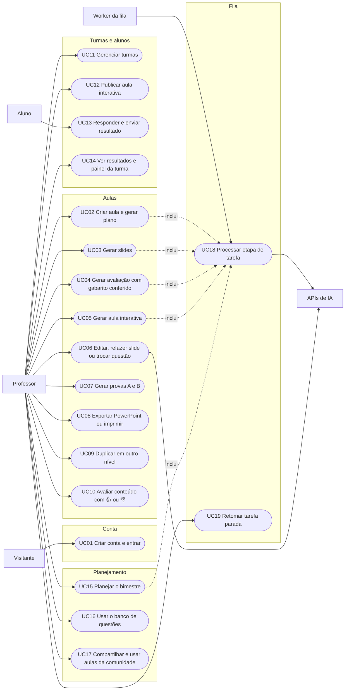

# Casos de uso e regras de negócio

[← README](../README.md) · [Arquitetura](ARQUITETURA.md) · [Fluxo de dados](FLUXO_DADOS.md) · [Operação e deploy](OPERACAO_E_DEPLOY.md)

## 1. Atores

| Ator | Tipo | Como entra no sistema |
|---|---|---|
| Visitante | Pessoa sem login | Página de login (`public/index.html`) e apresentação (`public/conheca/`) |
| Professor | Usuário autenticado (Supabase Auth) | App em `/` com token Bearer em cada chamada |
| Aluno | Anônimo | Página pública `/a/:slug`, sem conta |
| Worker da fila | Sistema interno | `POST /api/r?rota=worker` com `x-worker-secret` (`lib/tarefas.js`) |
| APIs de IA | Sistema externo | Chamadas pelo servidor (`public/core/llm.js`) |
| Supabase Auth | Sistema externo | Login no navegador e validação do token no servidor |

Não há perfil de administrador nem job agendado no código. A única execução sem pedido de pessoa é o encadeamento da fila, que sempre começa por uma ação do professor.

## 2. Diagrama de casos de uso

## 3. Regras de negócio

| Código | Regra | Onde |
|---|---|---|
| RN01 | Série 1, 2 ou 3; assunto obrigatório com até 150 caracteres | `validarEntrada` (`public/core/gerador.js`), restrições do SQL |
| RN02 | Nível da aula: `regular`, `reforco`, `avancado` ou `inclusao` | `NIVEIS_VALIDOS`, `public/core/prompts.js`, SQL |
| RN03 | Slides e avaliação exigem plano; aula interativa exige slides | `PRE_REQUISITO` em `api/r.js` (409) |
| RN04 | Só uma tarefa ativa por tipo e aula: um segundo pedido devolve a tarefa existente | `POST /v1/aulas/:id/gerar` |
| RN05 | Gerar de novo uma parte pronta limpa só aquela parte (e as que dependem dela) e ignora o cache | `POST /v1/aulas/:id/gerar` |
| RN06 | Até `LIMITE_DIARIO` (padrão 400) pedidos à IA por professor por dia; respostas do cache não contam | `lib/ia.js` |
| RN07 | Todo gabarito é conferido por outro provedor; discursivas divergentes passam pelo SymPy e depois pela IA | `conferirProva` (`public/core/gerador.js`) |
| RN08 | Toda questão conferida ou trocada entra no banco de questões do professor | etapa `conferir`, rota `regerar-questao` |
| RN09 | Mudou a prova (edição, troca, banco, nova geração): as versões A/B antigas são apagadas | `estado.versoes = null` em `api/r.js` e `lib/tarefas.js` |
| RN10 | O plano cita habilidades da lista oficial BNCC (conferidas) e pode usar como referência um plano bem avaliado (👍) da mesma série e assunto | etapa `plano`, `conferirBncc`, `db.aulaDeReferencia` |
| RN11 | Publicar a aula interativa exige `estado.interativa.jogos`; publicar na comunidade exige plano | `POST /v1/aulas/:id/publicar` |
| RN12 | Professor só vê e altera os próprios dados; aula de outro professor responde 404 | `aulaDoProfessor` e similares, RLS |
| RN13 | Aluno não tem conta; envio com apelido de até 40 caracteres, no máximo 300 envios por aula a cada 10 minutos | `POST /v1/publica/:slug/resultado` |
| RN14 | Planejamento do bimestre: conteúdos de 3 a 2000 caracteres, de 2 a 20 aulas (padrão 8) | `POST /v1/sequencias`, SQL |

## 4. Especificação dos casos de uso

### UC01 Criar conta e entrar
- **Ator:** Visitante.
- **Pré-condições:** Supabase configurado (`GET /v1/status` devolve `autenticacao: "supabase"`).
- **Fluxo principal:** 1. Informa e-mail e senha (mínimo 6). 2. Clica em **Criar conta** (`signUp`). 3. Com confirmação de e-mail desligada, entra direto; com ela ligada, confirma pelo link e depois clica em **Entrar** (`signInWithPassword`).
- **Alternativos/exceções:** link por e-mail (`signInWithOtp`); **Esqueci / criar senha** (`resetPasswordForEmail`, depois janela de nova senha no evento `PASSWORD_RECOVERY`); e-mail já cadastrado → aviso, detectado por `identities` vazio; erros do Supabase traduzidos (`traduzirErro`); modo de demonstração → só e-mail (`POST /v1/login-demo`).
- **Pós-condições:** sessão salva no navegador; gatilho `criar_perfil` cria a linha em `perfis`.

### UC02 Criar aula e gerar plano
- **Ator:** Professor.
- **Pré-condições:** logado; ao menos um provedor de IA configurado (ou `LLM_MOCK=1`).
- **Fluxo principal:** 1. Em **Nova aula** (`#/nova`), escolhe série, assunto, nível e, se quiser, turma, bimestre e observações. 2. `POST /v1/aulas` valida (RN01, RN02) e cria a aula. 3. Cria a tarefa `plano` (etapas `visao` e `plano`). 4. A tela da aula mostra o progresso. 5. O plano aparece pronto para revisar.
- **Alternativos/exceções:** entrada inválida → 400; turma ou sequência de outro professor → 404; limite diário → etapa com erro (RN06); todos os provedores falham → etapa com erro e tarefa `erro`, com opção de tentar de novo.
- **Pós-condições:** `aulas` com `estado.visao`, `estado.plano` e `titulo`; tarefa `pronta`.

### UC03 Gerar slides
- **Ator:** Professor.
- **Pré-condições:** plano pronto (RN03).
- **Fluxo principal:** 1. Clica em gerar slides. 2. `POST /v1/aulas/:id/gerar` com `tipo: "slides"`. 3. Para cada seção de `public/core/estrutura.js`: material, depois slides. 4. `montar-slides` junta a apresentação. 5. Pré-visualização em miniaturas.
- **Alternativos/exceções:** sem plano → 409; falha no material de uma seção → os slides daquela seção e a montagem ficam com erro (`dependeDeFalha`); geração repetida → RN05.
- **Pós-condições:** `estado.materiais`, `estado.secoes`, `estado.slides`.

### UC04 Gerar avaliação com gabarito conferido
- **Ator:** Professor.
- **Pré-condições:** plano pronto.
- **Fluxo principal:** 1. Pede a avaliação. 2. Etapas `questoes:multipla` e `questoes:discursiva`. 3. Etapa `conferir`: outro provedor resolve tudo; múltipla escolha compara a letra; discursivas que não batem vão ao SymPy e depois à IA (RN07). 4. Questões salvas no banco (RN08). 5. A tela marca as questões a revisar.
- **Alternativos/exceções:** SymPy indisponível (local ou erro) → só IA, método `ia`; conferência não concluída → etapa `conferir` com erro, mas a prova fica salva para revisão.
- **Pós-condições:** `estado.prova`, `estado.verificacao`, `estado.versoes = null`; linhas novas em `questoes`.

### UC05 Gerar aula interativa
- **Ator:** Professor.
- **Pré-condições:** slides prontos (RN03).
- **Fluxo principal:** 1. Pede a aula interativa. 2. Etapas `artigo:<seção>`, `visualizacoes` e `jogos`. 3. A tela mostra a prévia, montada no navegador com `montarPaginaInterativa`.
- **Alternativos/exceções:** `visualizacoes` falha → é opcional, e a página sai sem gráficos; falha em `jogos` → tarefa com erro, e a aula não pode ser publicada.
- **Pós-condições:** `estado.interativa` com `secoes`, `visualizacoes` e `jogos`.

### UC06 Editar, refazer slide ou trocar questão
- **Ator:** Professor.
- **Pré-condições:** a parte correspondente existe.
- **Fluxo principal:** 1a. Edita plano, slides ou prova e salva (`PATCH /v1/aulas/:id`, até 400 KB por parte). 1b. Ou pede para refazer um slide (`POST /v1/aulas/:id/regerar-slide`, com pedido opcional de até 500 caracteres). 1c. Ou troca uma questão (`POST /v1/aulas/:id/regerar-questao`).
- **Alternativos/exceções:** índice ou número inexistente → 404; conteúdo inválido ou grande demais → 400; IA indisponível → 503; limite diário → 429.
- **Pós-condições:** `estado` atualizado; questão trocada marcada como `nova` e enviada ao banco; versões A/B apagadas quando a prova muda (RN09).

### UC07 Gerar provas A e B
- **Ator:** Professor.
- **Pré-condições:** avaliação pronta.
- **Fluxo principal:** `POST /v1/aulas/:id/versoes` embaralha questões e alternativas com semente (`criarVersoes` em `public/core/versoes.js`) e devolve as duas versões e seus gabaritos.
- **Alternativos/exceções:** sem avaliação → 409.
- **Pós-condições:** `estado.versoes` preenchido.

### UC08 Exportar PowerPoint ou imprimir
- **Ator:** Professor.
- **Pré-condições:** a parte existe.
- **Fluxo principal:** slides → `.pptx` montado no navegador (`public/pptx.js`, pptxgenjs da CDN), com fórmulas em imagem ou texto Unicode (`public/pptx-matematica.js`); plano, prova e gabarito → impressão do navegador, filtrada por `body[data-imprimir]` (dá para salvar em PDF); apresentação em tela cheia → `public/slides.html` (Reveal.js); fórmulas em destaque no .pptx viram imagem com MathJax, carregado só na exportação.
- **Alternativos/exceções:** CDN indisponível → a exportação não carrega.
- **Pós-condições:** nenhuma no servidor.

### UC09 Duplicar em outro nível
- **Ator:** Professor.
- **Fluxo principal:** `POST /v1/aulas/:id/duplicar` com `nivel`. Mesmo nível → cópia com o mesmo `estado` e título "(cópia)". Outro nível → aula nova vazia com `origem_id` e tarefa `plano` iniciada.
- **Alternativos/exceções:** nível inválido → 400.
- **Pós-condições:** nova linha em `aulas` ligada pela `origem_id`.

### UC10 Avaliar conteúdo com 👍 ou 👎
- **Ator:** Professor.
- **Fluxo principal:** `POST /v1/aulas/:id/avaliar` com `parte`, `nota` (1 ou -1) e comentário opcional.
- **Pós-condições:** linha em `avaliacoes_conteudo`; planos com 👍 podem servir de referência para outros planos (RN10).

### UC11 Gerenciar turmas
- **Ator:** Professor.
- **Fluxo principal:** listar (`GET /v1/turmas`, com o total de aulas), criar (`POST /v1/turmas`, nome obrigatório até 80, série, ano letivo) e excluir (`DELETE /v1/turmas/:id`).
- **Alternativos/exceções:** sem nome → 400.
- **Pós-condições:** ao excluir a turma, as aulas ficam sem turma (`on delete set null`).

### UC12 Publicar aula interativa
- **Ator:** Professor.
- **Pré-condições:** aula interativa gerada (RN11).
- **Fluxo principal:** 1. `POST /v1/aulas/:id/publicar` com `publica: true`. 2. O servidor cria o `slug`. 3. A tela mostra o link `/a/<slug>`, o QR Code (desenhado no navegador com qrcode-generator) e os botões **Postar no Google Classroom** e **Enviar no WhatsApp** (links de compartilhamento).
- **Alternativos/exceções:** sem jogos → 409; despublicar com `publica: false` → o link passa a mostrar "aula não disponível".
- **Pós-condições:** `aulas.publica = true`, `slug` preenchido.

### UC13 Responder e enviar resultado
- **Ator:** Aluno.
- **Pré-condições:** link válido de aula publicada.
- **Fluxo principal:** 1. Abre `/a/<slug>` (`GET publica/:slug`). 2. Lê as partes, mexe nos gráficos e responde aos jogos. 3. Informa o apelido e envia (`POST /v1/publica/:slug/resultado`).
- **Alternativos/exceções:** aula inexistente ou sem jogos → página 404 em HTML; dados inválidos → 400; excesso de envios → 429 (RN13); o navegador lembra que já enviou e não reenvia.
- **Pós-condições:** linha em `resultados` com `detalhes.erros`.

### UC14 Ver resultados e painel da turma
- **Ator:** Professor.
- **Fluxo principal:** por aula, `GET /v1/aulas/:id/resultados`; por turma, `GET /v1/turmas/:id/painel`. `resumirResultados` (`lib/resultados.js`) calcula envios, média e itens mais errados.
- **Pós-condições:** nenhuma.

### UC15 Planejar o bimestre
- **Ator:** Professor.
- **Fluxo principal:** 1. Informa conteúdos, série, bimestre, quantidade e turma (`POST /v1/sequencias`). 2. Tarefa `sequencia` gera a lista de aulas. 3. Em cada item, **criar aula** abre a nova aula já preenchida; ao salvar, `POST /v1/aulas` com `sequencia_id` e `ordem` grava o `aula_id` no item.
- **Alternativos/exceções:** conteúdos com menos de 3 caracteres → 400 (RN14).
- **Pós-condições:** `sequencias.itens` preenchido; itens ligados às aulas criadas.

### UC16 Usar o banco de questões
- **Ator:** Professor.
- **Fluxo principal:** listar com filtros de série, tipo e busca (`GET /v1/questoes`), excluir (`DELETE /v1/questoes/:id`) ou adicionar à prova de uma aula (`POST /v1/aulas/:id/questoes-do-banco`, até 30).
- **Alternativos/exceções:** nenhuma questão válida → 400.
- **Pós-condições:** questões copiadas para `estado.prova` com `verificacao.do_banco`; versões A/B apagadas.

### UC17 Compartilhar e usar aulas da comunidade
- **Ator:** Professor.
- **Fluxo principal:** 1. Marca a aula para a comunidade (`POST /v1/aulas/:id/publicar` com `comunidade: true`). 2. Outros professores listam (`GET /v1/comunidade`, por curtidas), curtem (`POST /v1/comunidade/:id/curtir`, alterna) e copiam (`POST /v1/comunidade/:id/usar`).
- **Alternativos/exceções:** aula sem plano → 409; aula fora da comunidade → 404.
- **Pós-condições:** cópia com `origem_id` na conta de quem usou; curtidas em `curtidas`.

### UC18 Processar etapa de tarefa
- **Ator:** Worker da fila.
- **Pré-condições:** tarefa `pendente` ou `rodando` com etapa `aguardando`.
- **Fluxo principal:** 1. Pega a trava (`travar_tarefa`, 240 s). 2. Executa a próxima etapa (`executar` em `lib/tarefas.js`). 3. Salva o resultado em `aulas.estado` ou `sequencias` e a etapa como `pronto`. 4. Chama o worker de novo para a etapa seguinte.
- **Alternativos/exceções:** trava ocupada → não faz nada; aula excluída → tarefa `erro`; etapa falha → `erro` na etapa e segue para as outras; segredo errado → 401.
- **Pós-condições:** sem etapas restantes → tarefa `pronta`, ou `erro` com a lista do que falhou.

### UC19 Retomar tarefa parada
- **Ator:** Professor (indireto, ao abrir a aula ou consultar a tarefa).
- **Pré-condições:** tarefa ativa, sem trava válida e sem atualização há mais de 20 s.
- **Fluxo principal:** `GET /v1/aulas/:id`, `GET /v1/tarefas/:id`, `POST /v1/tarefas/:id/continuar` ou `GET /v1/sequencias/:id` chamam `retomarSeParada`, que roda a próxima etapa ali mesmo.
- **Pós-condições:** a fila volta a andar.

### Outros
- Excluir aula: `DELETE /v1/aulas/:id` (tarefas, resultados, curtidas e avaliações saem em cascata; questões ficam com `aula_id` nulo).
- Excluir sequência: `DELETE /v1/sequencias/:id`.
