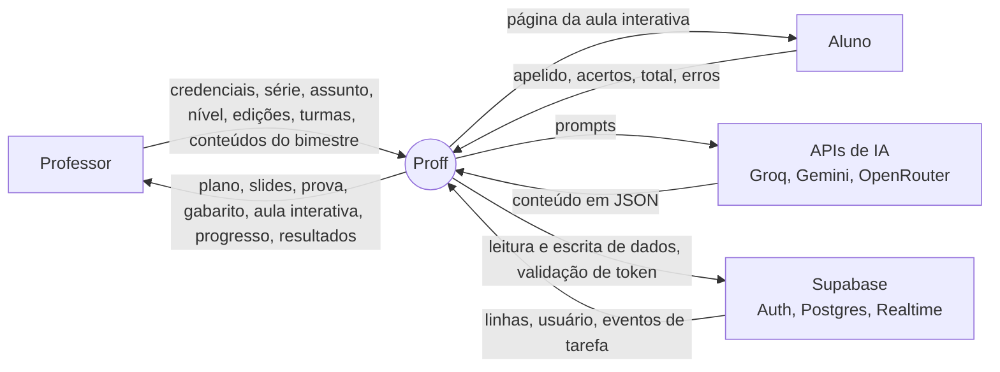
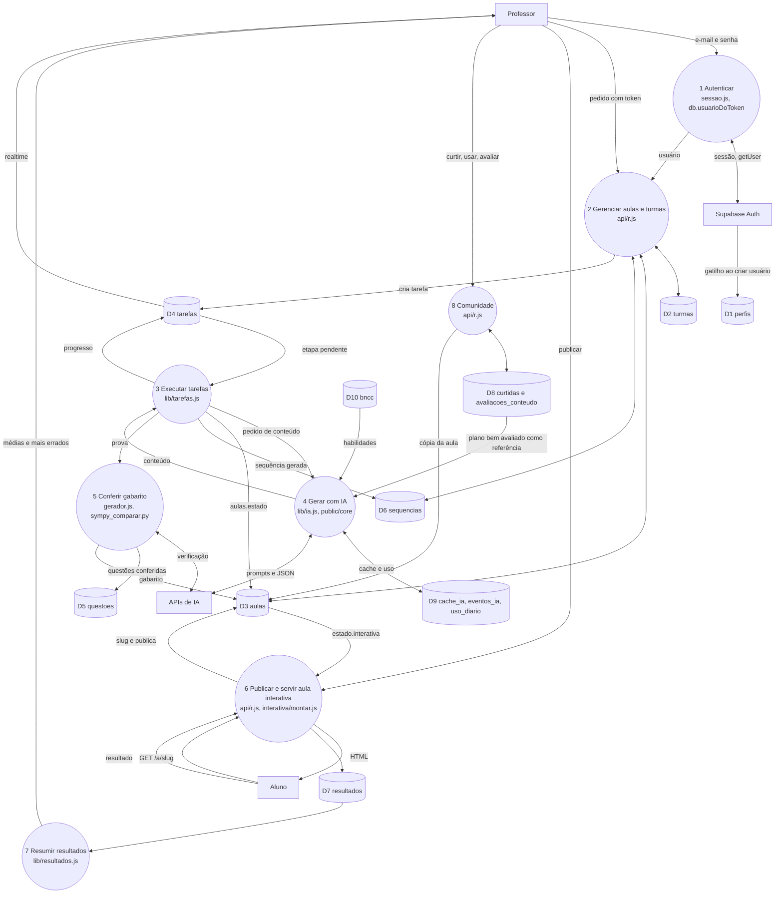
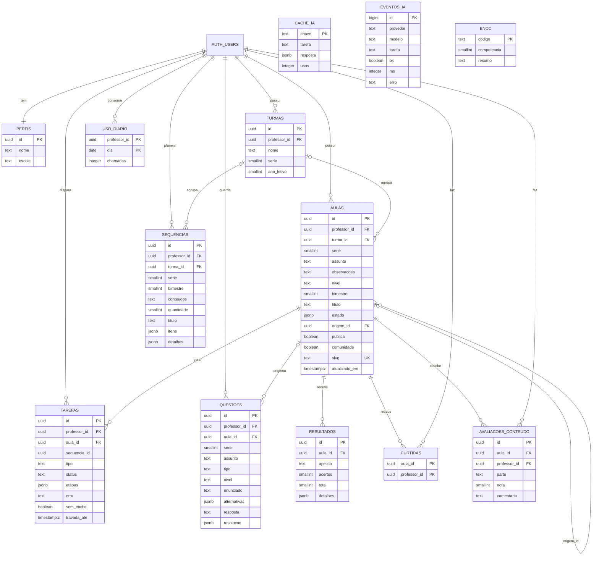

# Fluxo de dados e modelo de dados

[← README](../README.md) · [Arquitetura](ARQUITETURA.md) · [Casos de uso](CASOS_DE_USO.md) · [Operação e deploy](OPERACAO_E_DEPLOY.md)

## 1. DFD nível 0 (contexto)



## 2. DFD nível 1 (detalhado)

Processos numerados; armazenamentos são as tabelas do Postgres (`supabase/migrations/20261124000000_proff.sql`).



## 3. Modelo de dados



Observações:
- `tarefas.sequencia_id` e `sequencias.itens[].aula_id` **não** são chaves estrangeiras: a ligação é feita no código (`lib/tarefas.js`, rota `POST /v1/aulas`).
- `cache_ia`, `eventos_ia` e `bncc` não se ligam a nenhuma tabela.
- Funções no banco: `registrar_uso(p_professor)` (soma e devolve as chamadas do dia), `travar_tarefa(p_tarefa, p_segundos)` (pega a trava se estiver livre), `saude_provedores(p_minutos)` (total e erros por provedor), `criar_perfil()` (gatilho em `auth.users`) e `tocar_atualizado_em()` (gatilho em `aulas` e `tarefas`).
- Toda função de `lib/db.js` tem uma versão em memória (objeto `M`) para `DB_MEMORIA=1`.

### Entidades do domínio

| Entidade | O que é | Regras no banco |
|---|---|---|
| `aulas` | Uma aula de um assunto para uma série, com todo o conteúdo gerado em `estado` | série 1 a 3; assunto até 150 caracteres; observações até 1500; nível `regular`, `reforco`, `avancado` ou `inclusao`; bimestre 1 a 4; `slug` único |
| `turmas` | Agrupa aulas e sequências de um professor | nome de 1 a 80 caracteres; série 1 a 3 |
| `tarefas` | Uma geração em andamento ou terminada | tipo `plano`, `slides`, `prova`, `interativa` ou `sequencia`; status `pendente`, `rodando`, `pronta` ou `erro` |
| `questoes` | Banco de questões do professor, alimentado pela conferência e por "trocar questão" | tipo `multipla` ou `discursiva` |
| `sequencias` | Planejamento do bimestre: lista de aulas (`itens`) e planejamento detalhado (`detalhes.planejamento`: ementa, habilidades, objetivos, conteúdos, competências, avaliação; `detalhes.cabecalho`: professor, escola, turma do .docx) | conteúdos até 2000 caracteres; quantidade de 2 a 20 |
| `resultados` | Envio de um aluno na aula interativa | apelido de 1 a 40; acertos ≥ 0; total > 0 |
| `curtidas`, `avaliacoes_conteudo` | Curtidas na comunidade e 👍/👎 do professor por parte da aula | nota -1 ou 1; parte `plano`, `slides`, `prova` ou `interativa` |
| `bncc` | As 43 habilidades EM13MAT (código, competência, resumo) | código no formato `EM13MAT[1-5]NN`; espelhada em `lib/bncc.js` |

### Estrutura de `aulas.estado` (jsonb)

Preenchida etapa por etapa pela fila (`lib/tarefas.js`) e editável pelo professor (`PATCH /v1/aulas/:id` aceita `plano`, `slides` e `prova`).

| Chave | Preenchida por | Conteúdo |
|---|---|---|
| `visao` | etapa `visao` | Visão geral do tema usada pelos outros prompts |
| `plano` | etapa `plano` | Plano de aula (inclui `titulo` e habilidades BNCC conferidas) |
| `materiais.<seção>` | etapa `material` ou `artigo` | Material de cada seção da aula |
| `secoes.<seção>` | etapa `formatar` | Slides de cada seção |
| `slides` | etapa `montar-slides` | Apresentação completa (`slides.slides[]`) |
| `questoes.multipla`, `questoes.discursiva` | etapas `questoes:*` | Questões antes da conferência |
| `prova` | etapa `conferir` ou `questoes-do-banco` | `titulo`, `instrucoes`, `questoes[]` (cada uma com `numero`, `tipo`, `enunciado`, `alternativas`, `resposta`, `resolucao`, `verificacao`) |
| `verificacao` | etapa `conferir` | Resultado da conferência (`concluida`, `metodo` `ia` ou `sympy+ia`, `provedor`) |
| `versoes` | `POST /v1/aulas/:id/versoes` | Provas A e B; volta a `null` quando a prova muda |
| `interativa` | etapas `artigo`, `visualizacoes`, `jogos` | `secoes`, `visualizacoes`, `jogos` (a aula só é publicável com `jogos`) |

## 4. Contratos críticos

Todas as rotas respondem JSON. Em erro: `{ "erro": "mensagem" }` com o status da [tabela de erros](ARQUITETURA.md#4-tratamento-de-erros).

### `GET /v1/status` (sem login)

```json
{ "proff": true, "modo": "servidor", "autenticacao": "supabase", "supabase": { "url": "https://xxxx.supabase.co", "anonKey": "sb_publishable_..." }, "provedores": ["groq", "gemini"], "limiteDiario": 400 }
```
No modo memória: `"autenticacao": "demo"` e `"supabase": null`.

### `POST /v1/aulas`

Entrada (validada por `validarEntrada` em `public/core/gerador.js` e pelo roteador):

| Campo | Regra |
|---|---|
| `serie` | `"1"`, `"2"` ou `"3"` (obrigatório) |
| `assunto` | texto de 1 a 150 caracteres (obrigatório) |
| `observacoes` | texto opcional |
| `nivel` | `regular` (padrão), `reforco`, `avancado` ou `inclusao` |
| `turma_id` | UUID de uma turma do professor (opcional) |
| `bimestre` | 1 a 4 (opcional) |
| `sequencia_id`, `ordem` | liga a aula a um item do planejamento do bimestre (opcional) |

Saída: `{ "aula": {...}, "tarefa": {...} }`. A tarefa já começa com o tipo `plano`.

### Objeto `tarefa`

```json
{ "id": "uuid", "tipo": "slides", "status": "rodando", "erro": null,
  "etapas": [ { "id": "material:introducao", "rotulo": "Parte 1: ... — material", "situacao": "pronto", "detalhe": "groq" } ] }
```
`situacao`: `aguardando`, `gerando`, `pronto` ou `erro`. A etapa pode ter `opcional: true`.

### `POST /v1/aulas/:id/gerar`

Entrada: `{ "tipo": "plano" | "slides" | "prova" | "interativa", "novo": false }`. Exige plano antes de slides e prova, e slides antes da interativa (409). Se já existe tarefa ativa do mesmo tipo, devolve ela. Se a parte já está pronta ou `novo` é verdadeiro, limpa a parte e gera de novo sem cache.

### `POST /v1/publica/:slug/resultado` (sem login)

```json
{ "apelido": "Ana B.", "acertos": 12, "total": 14, "erros": ["quiz:2", "vf:1"] }
```
Regras: apelido até 40 caracteres sem `<`/`>`; `total` de 1 a 100; `acertos` ≤ `total`; até 50 códigos de erro no formato `(quiz|vf|par|desafio):N`; 429 acima de 300 envios em 10 minutos por aula.

### Planejamento do bimestre

- `POST /v1/sequencias` `{ serie, bimestre, quantidade, conteudos, turma_id }` → `{ sequencia, tarefa }` (etapas `sequencia` e `planejamento`).
- `POST /v1/sequencias/:id/detalhar` → `{ tarefa }` só com a etapa `planejamento` (409 se a lista de aulas ainda não existe).
- `PATCH /v1/sequencias/:id` `{ professor, escola, turma }` → `{ sequencia }` com `detalhes.cabecalho`. 503 com instrução se o banco não tem a coluna `detalhes`.
- `detalhes.planejamento`: `{ ementa, habilidades: [{ codigo, descricao, competencia }], competencias_especificas: [3], objetivos: [], conteudos: [{ tema, topicos: [] }], competencias_gerais: [1, 2], avaliacao: [], recuperacao }`. O .docx é montado no navegador a partir desse objeto.

### `POST /api/sympy_comparar` (interno)

Cabeçalho `x-worker-secret` obrigatório. Entrada `{ "pares": [ { "a": "x = -1/2", "b": "-0,5" } ] }` (até 20 pares por chamada). Saída `{ "resultados": [true] }`: cada item é `true`, `false` ou `null` (não foi possível decidir).

### `POST /api/r?rota=worker` (interno)

Cabeçalho `x-worker-secret` obrigatório. Entrada `{ "tarefa": "uuid" }`. Resposta 202 `{ "aceito": true }`, e a etapa roda em segundo plano.
