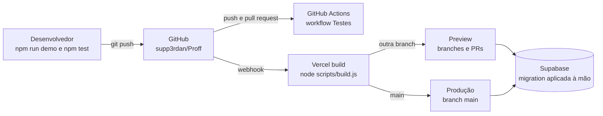

# Operação e deploy

[← README](../README.md) · [Arquitetura](ARQUITETURA.md) · [Fluxo de dados](FLUXO_DADOS.md) · [Casos de uso](CASOS_DE_USO.md)

Passo a passo de configuração do zero (Supabase, Vercel, URLs de login): **[CONFIGURACAO.md](CONFIGURACAO.md)**. Este documento descreve o ciclo de vida e a operação.

## 1. Ciclo de vida



| Etapa | Onde | O que faz |
|---|---|---|
| Testes | `.github/workflows/testes.yml` | Em todo push e PR: Node 22, Python 3.12, `npm ci`, `pip install -r requirements.txt`, `npm test`. Não faz deploy. |
| Decisão de build | `vercel.json` → `ignoreCommand` | Pula o deploy quando o commit só muda `.claude/` ou arquivos `.md` |
| Build | `vercel.json` → `buildCommand: node scripts/build.js` | Troca `__VERSAO__` pelos 7 primeiros caracteres do commit (`VERCEL_GIT_COMMIT_SHA`) nos `.js`, `.html` e `.css` de `public/` |
| Saída estática | `outputDirectory: public` | Tudo em `public/` é servido como arquivo |
| Funções | `api/r.js` (Node, `maxDuration` 300 s, inclui `public/core/**`, `public/interativa/**`, `lib/**`); `api/sympy_comparar.py` (Python, 30 s, `requirements.txt`) | API e conferência simbólica |
| Reescritas | `/v1/:rota*` → `/api/r?rota=:rota*`; `/a/:slug` → `/api/r?rota=publica/:slug` | Endereços curtos da API e da aula do aluno |
| Redirecionamento | `/conheca` → `/conheca/` (permanente) | Caminhos relativos da apresentação |
| Banco | `supabase/migrations/20261124000000_proff.sql` | Rodado à mão no SQL Editor do Supabase; pode ser rodado de novo |

**Containerização:** não há. O projeto não tem Dockerfile nem docker-compose; o ambiente de execução é o da Vercel (funções serverless) e, localmente, `node server.js`.

> ⚠️ Não rode `npm run build` na pasta de trabalho: ele **reescreve `public/` no lugar** e os endereços passam a ter uma versão fixa. Se rodar sem querer, desfaça com `git restore public` **só se não houver alterações suas** em `public/`.

## 2. Variáveis de ambiente

Modelo: [`.env.example`](../.env.example). Local: copie para `.env` (o `server.js` lê sem dependências e não sobrescreve variáveis já definidas). Na Vercel: **Settings → Environment Variables**.

| Variável | Obrigatória | Descrição | Exemplo seguro |
|---|---|---|---|
| `SUPABASE_URL` | sim (produção) | Endereço do projeto; o servidor limpa barra final e caminhos (`urlSupabase()`) | `https://abcdefgh.supabase.co` |
| `SUPABASE_ANON_KEY` | sim (produção) | Chave pública, entregue ao navegador por `GET /v1/status` | `sb_publishable_xxxxxxxx` |
| `SUPABASE_SERVICE_ROLE_KEY` | sim (produção) | Chave secreta, só no servidor; ignora RLS | `sb_secret_xxxxxxxx` |
| `GROQ_API_KEY` | ao menos uma chave de IA | Groq (texto e matemática) | `gsk_xxxxxxxx` |
| `GEMINI_API_KEY` | ao menos uma chave de IA | Gemini | `AIzaxxxxxxxx` |
| `OPENROUTER_API_KEY` | ao menos uma chave de IA | OpenRouter (modelos gratuitos) | `sk-or-v1-xxxxxxxx` |
| `WORKER_SECRET` | sim (produção) | Protege o worker da fila e a função SymPy | texto aleatório de 40+ caracteres (`openssl rand -hex 32`) |
| `APP_URL` | recomendada, só em Production | Endereço usado pela fila para chamar a si mesma; nos previews vale `VERCEL_URL` | `https://proff-math.vercel.app` |
| `VERCEL_AUTOMATION_BYPASS_SECRET` | nos previews protegidos | Criada pela Vercel ao ativar "Protection Bypass for Automation" | (gerada pela Vercel) |
| `LIMITE_DIARIO` | não | Pedidos à IA por professor por dia | `400` |
| `LLM_TIMEOUT_MS` | não | Tempo limite por chamada de IA | `90000` |
| `GROQ_MODEL`, `GEMINI_MODEL`, `OPENROUTER_MODEL` | não | Força um modelo; vazio usa as listas de `public/core/llm.js` | vazio |
| `IA_ESPERA_MS` | não | Espera antes da nova tentativa quando todos os provedores falham | `4000` |
| `DB_MEMORIA` | só desenvolvimento | `1` = banco em memória e login de demonstração | `1` |
| `LLM_MOCK` | só desenvolvimento | `1` = IA simulada (`public/core/mock.js`) | `1` |
| `FILA_HTTP` | só testes | `1` = encadeia a fila por HTTP também no modo memória | `1` |
| `PORT` | só local | Porta do `server.js` | `3000` |

Nomes alternativos aceitos por compatibilidade (`lib/ia.js`): `GROK_API_SECRET_TRUE` para o Groq e `API_KEY_GROQ` para o OpenRouter. Chaves coladas na variável errada são reconhecidas pelo prefixo (`corrigirChaves`).

## 3. Execução local

```bash
npm ci
pip install -r requirements.txt   # só para os testes Python
npm run demo                      # sem Supabase e sem IA → http://localhost:3000
cp .env.example .env && npm run dev   # com Supabase e chaves reais
npm test
```

`server.js` serve `public/`, imita as reescritas `/v1/*` e `/a/:slug`, redireciona pastas sem barra final e responde 501 em `/api/sympy_comparar` (a conferência fica só com a IA).

## 4. Monitoramento

| O que olhar | Onde |
|---|---|
| Erros das funções | Vercel → Deployments → (deploy) → Logs |
| Saúde dos provedores de IA | tabela `eventos_ia` (ou `select * from saude_provedores(30)`) |
| Uso por professor | tabela `uso_diario` |
| Gerações travadas | `select id, tipo, status, etapas, atualizado_em from tarefas where status in ('pendente','rodando')` |
| Provedores ativos | topo do app, ou `GET /v1/status` |

Limpeza opcional comentada no fim da migration: apagar `eventos_ia` e `cache_ia` antigos de tempos em tempos (não há rotina automática).

## 5. Solução de problemas

| Sintoma | Causa provável | O que fazer |
|---|---|---|
| "O servidor do Proff não respondeu" ao abrir o site | Função com erro ou variáveis faltando | Ver os logs da Vercel; conferir `SUPABASE_URL`, `SUPABASE_SERVICE_ROLE_KEY` |
| Login mostra "Invalid path specified in request URL" | `SUPABASE_URL` com caminho extra | Deixar só `https://xxxx.supabase.co` (o servidor já limpa, mas confira em `GET /v1/status`) |
| Conta criada não consegue entrar | "Confirm email" ligado e e-mail não chegou (limite do SMTP gratuito) | Desligar em Authentication → Sign In / Providers → User Signups, ou configurar SMTP próprio |
| "E-mail ou senha incorretos" para quem entrou por link | Conta sem senha | Usar **Esqueci / criar senha** ou o botão **Senha** depois de entrar |
| Link de login ou recuperação volta para endereço errado | Site URL ou Redirect URLs do Supabase | Authentication → URL Configuration ([CONFIGURACAO.md](CONFIGURACAO.md), item 3) |
| Topo mostra "IA não configurada" | Nenhuma chave de IA no ambiente | Cadastrar ao menos uma chave e fazer **Redeploy** |
| Geração parada em uma etapa | Worker não conseguiu chamar a próxima execução (sem `APP_URL`/`WORKER_SECRET`, preview protegido) | Conferir `WORKER_SECRET`, `APP_URL` e o bypass nos previews; reabrir a aula retoma a tarefa (`retomarSeParada`) |
| Etapa com erro 401 ou "chave" | Chave inválida ou na variável errada | Conferir o prefixo da chave e a variável |
| Erro 429 "Limite diário" | Professor passou de `LIMITE_DIARIO` | Esperar o dia seguinte ou aumentar a variável |
| Erros 503 ou "demorou" em várias etapas | Provedor instável ou modelo desativado | O sistema troca sozinho; ver `eventos_ia`; adicionar outra chave de provedor |
| Gabarito com método só "ia" em produção | SymPy falhou ou `WORKER_SECRET` diferente | Ver logs de `api/sympy_comparar.py` |
| Fórmulas aparecem como texto | KaTeX da CDN não carregou | Conferir acesso ao jsDelivr (bloqueadores, rede da escola) |
| Navegador mostra versão antiga | Cache | Recarregar; conferir se o build trocou `__VERSAO__` |
| Aluno vê "Esta aula não está mais disponível" | Aula despublicada, excluída ou sem jogos | Gerar a aula interativa e ativar o link de novo |
| Link do aluno pede login da Vercel | Proteção de previews | Usar o link de produção |
| Projeto do Supabase pausado | Inatividade no plano gratuito | Reativar no painel do Supabase |
